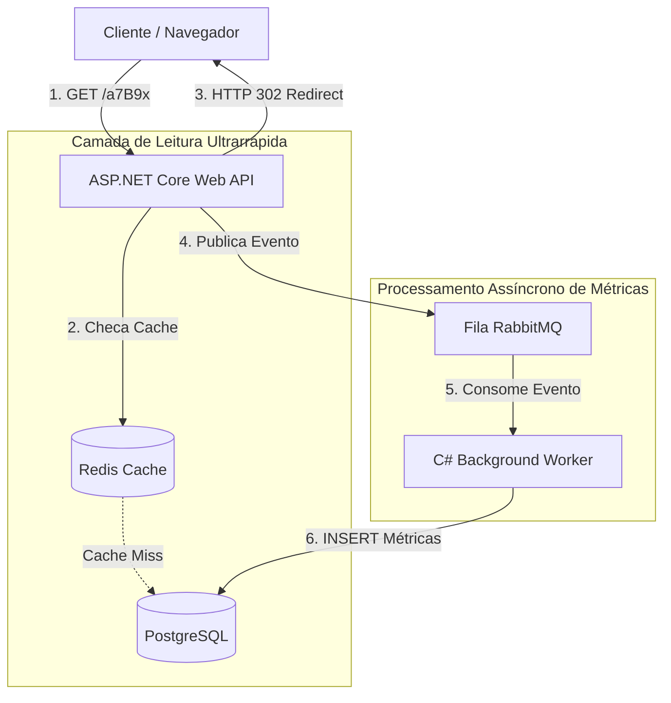

# Especificação de Arquitetura & Decisões Técnicas (ADR)
## Projeto: Encurtador de Links de Alta Performance (C# .NET)

> **Documento Vivo de Engenharia de Software**  
> **Autor:** Murilo Vidotti  
> **Papel:** Desenvolvedor Backend / Arquiteto de Software  
> **Status:** Em Concepção e Design Técnico  

---

## 1. Visão Geral do Produto
O objetivo do projeto é construir um encurtador de URLs resiliente, seguro e de latência ultrabaixa ($< 10\text{ ms}$ no redirecionamento), capaz de suportar alto volume de leituras e registrar métricas analíticas de cliques sem degradar a experiência do usuário.

---

## 2. Requisitos do Sistema

### Requisitos Funcionais (RF)
- **RF01:** O usuário autenticado ou anônimo pode fornecer uma URL longa e receber um link encurtado único (ex: `https://meu.link/a7B9x`).
- **RF02:** Qualquer usuário ao acessar a URL encurtada deve ser redirecionado (HTTP 302) para a URL original.
- **RF03:** O criador do link pode definir uma data de expiração (`expires_at`) ou desativar o link manualmente (`is_active = false`).
- **RF04:** O sistema deve coletar métricas de cada clique (IP do solicitante, data/hora exata, cabeçalho `User-Agent` para identificação de navegador/SO).

### Requisitos Não-Funcionais (RNF)
- **RNF01 (Latência de Redirecionamento):** Tempo de resposta do endpoint de redirecionamento inferior a $10\text{ ms}$ em 99% das requisições (p99).
- **RNF02 (Resiliência sob Alta Concorrência):** Se um link sofrer milhares de cliques simultâneos, o banco de dados não pode travar por concorrência de escrita.
- **RNF03 (Segurança e Ofuscação):** Os códigos curtos não podem ser sequenciais ou previsíveis (para evitar varredura maliciosa de URLs alheias).
- **RNF04 (Execução Padronizada):** O ambiente completo de dependências deve ser reproduzível localmente em 1 comando com Docker Compose.

---

## 3. Registro de Decisões Arquiteturais (ADRs)

### ADR-001: Estilo Arquitetural — Monólito Modular com Clean Architecture
* **Decisão:** Adotar Clean Architecture dentro de um Monólito Modular em C# (.NET 8/9).
* **Alternativas Analisadas:**
  * *Microsserviços:* Descartado para o estágio inicial. Adicionaria latência de rede entre chamadas, sobrecarga de deploy e complexidade operacional desnecessária (Overengineering).
  * *MVC Tradicional:* Descartado para a arquitetura de backend. O MVC é focado em camadas de apresentação/telas acopladas. Como o foco corporativo é uma Web API RESTful para alto desempenho, a Clean Architecture oferece isolamento superior.
* **Estrutura das Camadas:**
  * `Domain`: Entidades (`ShortenedUrl`, `ClickMetric`), regras de negócio puras e tipos de valor.
  * `Application`: Casos de uso (`CreateShortLink`, `RedirectLink`), contratos de interfaces e DTOs.
  * `Infrastructure`: Implementação do PostgreSQL (EF Core), Redis (Cache) e RabbitMQ (Mensageria).
  * `Api`: Controllers/Endpoints HTTP, documentação Swagger e middlewares.

---

### ADR-002: Estratégia de Cache — Redis com Padrão Cache-Aside
* **Decisão:** Inserir uma camada de cache distribuído em memória com **Redis** à frente do banco relacional.
* **Justificativa:** A proporção de acessos em um encurtador é de aproximadamente 100 leituras para cada 1 escrita. O Redis entrega respostas em submilisegundos diretamente da memória RAM.
* **Padrão:** *Cache-Aside* (a aplicação busca primeiro no Redis; em caso de *miss*, busca no PostgreSQL e popula o Redis).
* **Mitigações de Risco:**
  * *Cache Stampede:* Uso de travas distribuídas (*distributed lock*) para que apenas uma requisição vá ao banco em caso de expiração concorrente.
  * *Esgotamento de Memória:* Configuração de TTL (Time-To-Live) em links inativos e política de despejo LRU (*Least Recently Used*).
  * *Invalidação:* Ao desativar ou editar um link, a chave correspondente no Redis é imediatamente purgada.

---

### ADR-003: Geração de Código Encurtado — Base62 com Inversão de Dependência
* **Decisão:** Utilizar representação alfanumérica em **Base62** (`[0-9, a-z, A-Z]`), oferecendo $62^7 \approx 3,52$ trilhões de combinações únicas com 7 caracteres.
* **Mecanismo de Segurança:**
  * Para evitar que IDs sequenciais sejam deduzidos, a conversão usará um *salt* privado de embaralhamento matemático (padrão *Hashids*).
* **Separação de Camadas (SOLID - DIP):**
  * A `Application` define a interface abstrata `IUrlShortenerService`.
  * A `Infrastructure` implementa a codificação concreta. O domínio e os casos de uso não dependem de bibliotecas externas de terceiros.

---

### ADR-004: Processamento de Métricas — Mensageria Assíncrona com RabbitMQ
* **Decisão:** Desacoplar a gravação de métricas do fluxo HTTP de redirecionamento utilizando um Message Broker (**RabbitMQ**).
* **Justificativa:** Gravar cliques com `UPDATE/INSERT` síncrono causa bloqueio de linhas no banco relacional (*Row Lock Contention*) em links virais.
* **Fluxo:**
  1. A API devolve o `HTTP 302 Redirect` ao usuário em ~5ms.
  2. A API publica o evento assíncrono `LinkClickedEvent` na fila do RabbitMQ.
  3. Um `BackgroundService` em C# consome a fila e persiste os dados analíticos no PostgreSQL em lotes.

---

### ADR-005: Modelagem de Dados Relacional (PostgreSQL)
* **Tabela `shortened_urls`:**
  * `id` (BIGINT, Primary Key)
  * `short_code` (VARCHAR(10), UNIQUE INDEX) -> Busca $O(\log N)$ ultrarrápida.
  * `original_url` (TEXT, NOT NULL)
  * `user_id` (BIGINT, NULLABLE / FK)
  * `created_at` (TIMESTAMPTZ, NOT NULL)
  * `expires_at` (TIMESTAMPTZ, NULLABLE)
  * `is_active` (BOOLEAN, DEFAULT true) -> Suporte a Soft-Delete.
* **Tabela `click_metrics`:**
  * `id` (BIGINT, Primary Key)
  * `shortened_url_id` (BIGINT, FK)
  * `clicked_at` (TIMESTAMPTZ)
  * `ip_address` (VARCHAR(45))
  * `user_agent` (TEXT)

---

## 4. Diagrama Visual da Arquitetura

---

## 5. Próximos Passos (Roadmap de Execução)
1. **Infraestrutura Local:** Criação do `docker-compose.yml` (PostgreSQL, Redis, RabbitMQ Management).
2. **Scaffold da Solução .NET:** Criação da solução com as 4 camadas da Clean Architecture (`Domain`, `Application`, `Infrastructure`, `Api`).
3. **Domínio:** Entidades e testes unitários das regras de encurtamento.
